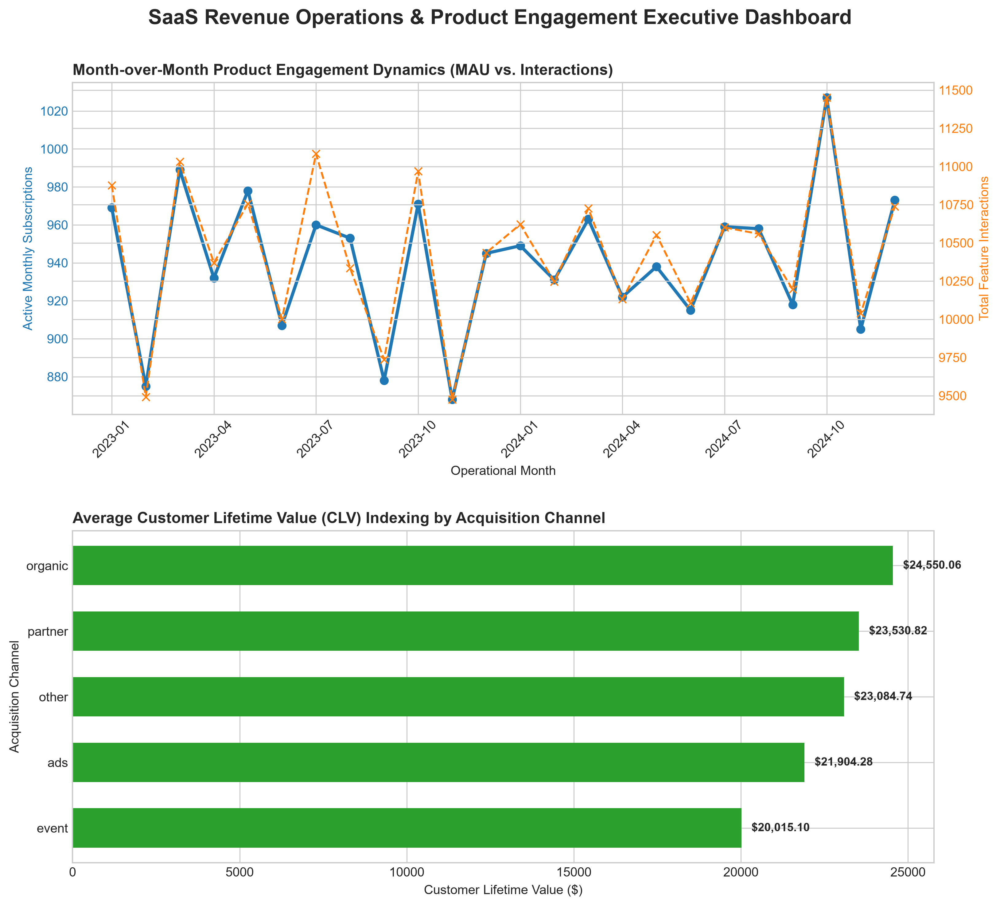

# SaaS Revenue Operations & Product Engagement Data Pipeline

## 🚀 Architectural Overview
This repository contains an end-to-end production data engineering and business intelligence pipeline. It extracts relational SaaS transactional data, transforms unoptimized fields, calculates critical SaaS operational metrics, and compiles executive metrics visualizations. 

The pipeline is built across **7 sequenced database schema layers** using standard SQL engines, coupled with an automated data science ingestion framework built using **Python (Pandas, NumPy, and Matplotlib)**.

---

## 🛠️ Data Infrastructure & Pipeline Directory

### 📦 1. Storage & Relational DDL Layers
*   `sql/sql_01_schema_database_architecture_initialization.sql` — **Data Definition Language (DDL).** Establishes explicit structural table parameters across 5 relational collections (`accounts`, `subscriptions`, `feature_usage`, `churn_events`, and `support_tickets`), dictating constraints, primary indices, and scalar datatypes.
*   `sql/sql_02_schema_staging_transformation_and_verification.sql` — **Data Quality Assurance (QA).** Executes early unified pipeline row counts to guarantee storage parity with source streams.
*   `sql/sql_03_schema_table_mapping_alignment.sql` — **Schema Normalization Layer.** Drops ephemeral staging files and maps core records to matching target productions to resolve schema anomalies.
*   `sql/sql_04_schema_production_data_cleaning.sql` — **Data Sanitation Engine.** Formats invalid string parameters and empty cells into true database `NULL` structures, securing calculation logic from metric degradation.

### 📊 2. Analytical Compute Layers (Production SQL Core)
*   `sql/sql_05_schema_monthly_active_users_(MAU)_trend_line.sql` — Parses chronological log points into fixed operational months to compute true Monthly Active Users (`COUNT(DISTINCT)`) and raw feature volumes.
*   `sql/sql_06_schema_cohort_retention_metrics.sql` — Implements double-nested **Common Table Expressions (CTEs)** and date math calculations to compile account survival percentages over a 24-month horizon, tracking customer retention by lifecycle start dates.
*   `sql/sql_07_schema_clv_by_channel.sql` — Joins contract volumes against user profiles to analyze financial unit economics. Integrates a production scale threshold filter (`HAVING total_acquired_customers >= 5`) to isolate lower-bound pipeline noise.

### 🎨 3. Automated Ingestion & Visualization Engine
*   `dashboard/generate_charts.py` — A production-ready Python compilation script that ingests query output buffers, converts structures into Pandas dataframes, and programmatically exports the executive graphic asset layer.

---

## 📈 System Analytics & Operational Findings

### 🔹 Product Engagement Performance (MAU Trend Analysis)
Platform activity displays high core product adoption. The system handles a structural operational base fluctuating between **850 and 1,025 active monthly subscriptions**. 
*   **Peak Infrastructure Loading:** **October 2024 (2024-10)** recorded maximum usage volume, processing **1,027 active subscriptions** and **11,450 platform actions**. 
*   **Engineering Takeaway:** User interactions scale in near-perfect lockstep with subscription volume. This high feature adoption density demonstrates strong application stickiness.

### 🔹 Strategic Unit Economics & Channel Yield (LTV Analysis)
Evaluating realized financial contract totals across client acquisition pathways isolates clear performance variance between channels:
*   🟢 **Organic Traffic (Premium Tier):** Yields the highest lifetime unit economics, returning a premium average Customer Lifetime Value of **\$24,550.06 per account** across 114 organizations.
*   🟡 **Partner Alliances (Mid Tier):** Demonstrates strong contract scalability, returning an average value of **\$23,530.82 per account** across 89 organizations.
*   🔴 **Paid Ads & Events (Lower Tier):** Paid Advertisements (\$21,904.28) and Event Activations (\$20,015.10) lag behind, resulting in higher acquisition costs but lower lifetime contract conversions.

### 🚀 Strategic Go-to-Market (GTM) Recommendation
**De-prioritize capital allocation for broad top-of-funnel paid ad placement and broad public event sponsorships.** Instead, reallocate marketing budgets directly into high-intent inbound SEO paths and co-marketed partner networks. Scaling pipelines with these methods captures traffic profiles that yield a **12% to 22% higher average Customer Lifetime Value**, maximizing total realized revenue.

---

## 🎨 Programmatic Executive Dashboard Layout


---

## ⚙️ Production Deployment & Replication Steps

To run the full data pipeline locally on your workstation:

1. **Mount Database Relational Layer:** Run the initial DDL script inside your SQL client to create the schema:
   ```sql
   /* Execute inside your database environment */
   .read sql/sql_01_schema_database_architecture_initialization.sql
   ```
2. **Ingest Relational Datasets:** Import your corresponding operational data tables from your storage directory into the database.
3. **Execute Clean and Verify Sequences:** Pass cleaning scripts 02 through 04 in order to verify data integrity:
   ```sql
   .read sql/sql_04_schema_production_data_cleaning.sql
   ```
4. **Compile Core Visualizations:** Navigate to your command prompt terminal and initialize the automated chart engine:
   ```bash
   python dashboard/generate_charts.py
   ```